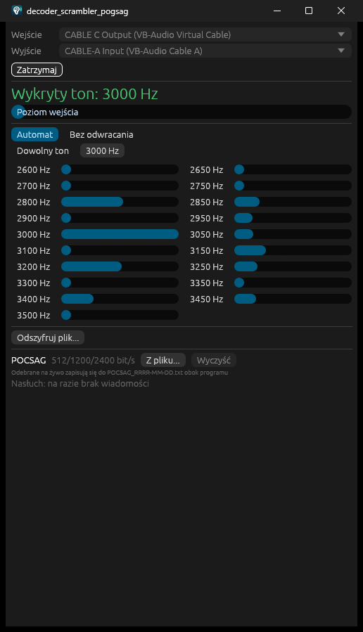

# Quansheng descrambler + POCSAG decoder for Windows (decoder_scrambler_pogsag)

> [!IMPORTANT]
> **🇵🇱 This program is in Polish.** The window, menus and messages are in Polish only.
> Polish documentation: [README.pl.md](README.pl.md)

Reverses the **voice scrambler of Quansheng radios** (UV-K5 and derivatives) and **detects the scrambler
tone automatically**. Works live (sound card input → output) and on files (WAV, MP3, FLAC, OGG).
Next to it runs a **POCSAG pager decoder** (512 / 1200 / 2400 bps), live from the same input or from files.



## What it supports

The Quansheng scrambler is a plain spectrum inversion: `f → tone − f`. The tone is set in the radio
menu from 2600 to 3500 Hz in 100 Hz steps (`BK4819_EnableScramble`: register 0x71 = `0x68DC + n * 1032`).

- The detector also scans **2000–4200 Hz in 5 Hz steps**, so it finds inversion scramblers of other
  radios too. Split-band inversion, rolling carriers and digital voice are not supported — for such
  signals the answer is "uncertain".
- Live mode: analysis every 0.25 s, the tone changes after 3 consistent results and is kept between
  transmissions; 0.6 s of silence resets the speech memory so stations are not mixed. Bars show the
  tone candidates every 50 Hz; clicking a tone sets it manually, "any tone" accepts any carrier.
- **POCSAG:** RIC, function, text and numeric reading, corrected bits. Live messages are also written
  to a daily file `POCSAG_YYYY-MM-DD.txt` next to the program.

## How the detection works

Voice harmonics lie at `k·F0`; after inversion at `tone − k·F0`. This is a comb with spacing F0 anchored
at 0 or at the tone. The comb phase in each frame tells where the anchor is (modulo F0), and the
variation of F0 between frames removes the ambiguity. The average spectrum is subtracted, so CTCSS and
steady tones do not disturb it; the speech envelope only breaks ties. Frames with fewer than 4 spectral
peaks are rejected (beeps are not voice).

## How the POCSAG decoder works

The radio audio path cuts low frequencies (CTCSS filter ~250 Hz) and applies de-emphasis, so the sign of
the signal gives 2–4 bad bits per word while BCH corrects only 2. The bit clock comes from the spectral
line of the squared derivative; decisions come from a linear equalizer with decision feedback, trained by
least squares on words of known content (sync, idle, BCH-valid words) over several passes — it adapts to
the radio by itself. A noise sieve rejects false addresses; the decoder is robust against lost sound-card
packets (10 ms gaps). Live: an 8 s window decoded every second (~75 ms of work).

## Usage

`decoder_scrambler_pogsag.exe`: choose the input from the receiver and the output to headphones, press
**Start**. The automatic mode needs a few seconds of speech. Devices are remembered in
`%APPDATA%\descrambler-quansheng.txt`.

Command line tool:

```
descrambler-cli wykryj <file>                      detect the tone
descrambler-cli odwroc <file> <out.wav> [--ton HZ] descramble (detects the tone without --ton)
descrambler-cli symuluj <file>                     simulate the live automatic mode
descrambler-cli pocsag <file>                      decode POCSAG
descrambler-cli urzadzenia                         list sound devices
descrambler-cli na-zywo <input> <output> <seconds> live descrambling
```

## Download

Windows x64 build in **[Releases](../../releases)**: `decoder_scrambler_pogsag.exe` (window) and
`descrambler-cli.exe` (command line) — no installation, no DLLs.

## Building and tests

Rust toolchain `x86_64-pc-windows-gnu`; `C:\msys64\mingw64\bin` (MSYS2: dlltool) must be in `PATH`:

```
cargo test --release --lib
cargo build --release --bins
```

Tests: inverter, detector and automatic mode on synthetic signals; POCSAG encoder, radio path (high-pass,
de-emphasis, inverted polarity, noise), lost samples, live decoding without duplicates. Python scripts in
[`testy/`](testy/) check detection on real speech scrambled by an independent implementation (scipy);
test speech: [Open Speech Repository](https://www.voiptroubleshooter.com/open_speech/) (`OSR_us_000_0010_8k`,
`0011`, `0030`, `OSR_uk_000_0020_8k`).

## Legal

Listening to and descrambling other people's communications may be restricted by law in your country.
Use it for your own radios and for transmissions you are allowed to receive.

## License and credits

[GPL-3.0](LICENSE) © 2026 SP9TKN.
The processing chain and the idea of the detection feature come from
[deinvert](https://github.com/windytan/deinvert) by Oona Räisänen (MIT); the code is written from scratch.
The POCSAG engine is shared with [pocsag-encoder-decoder](https://github.com/SP9TKN/pocsag-encoder-decoder).
Libraries: [egui / eframe](https://github.com/emilk/egui), [cpal](https://github.com/RustAudio/cpal),
[rustfft](https://github.com/ejmahler/RustFFT), [symphonia](https://github.com/pdeljanov/Symphonia),
[hound](https://github.com/ruuda/hound), [rfd](https://github.com/PolyMeilex/rfd).

**Tools:** developed with [Claude Code](https://claude.com/claude-code) (Anthropic) — AI assistant used
for coding, testing and documentation.
